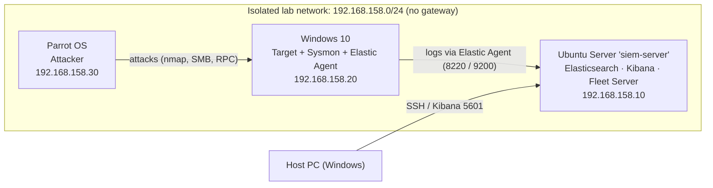

# SOC Home Lab: Detecting Attacks with Elastic SIEM

A self-built Security Operations Center (SOC) lab where I deployed an Elastic Stack SIEM, onboarded a Windows 10 endpoint with Sysmon and Elastic Agent, attacked it from a Parrot OS machine, and wrote custom detection rules for what I saw in the logs.

The goal was to practice the full blue-team loop: **collect → attack → investigate → detect → visualize**.

---
## Related project

- **[soc-detection-validator](https://github.com/fogaccacbr/soc-detection-validator)** — a Python tool that automatically re-runs these attacks and checks that each detection rule still fires, producing a coverage report. Turns the manual "attack → check Kibana" loop into one command.

## Highlights

- Deployed a **single-node Elastic Stack** (Elasticsearch, Kibana, Fleet Server) on Ubuntu Server, hardened with UFW.
- Onboarded a **Windows 10 endpoint** with advanced audit policy, PowerShell logging, **Sysmon (sysmon-modular)** and **Elastic Agent** managed by Fleet.
- Simulated attacks from **Parrot OS** mapped to **MITRE ATT&CK**: reconnaissance, SMB enumeration, brute force, persistence and data collection.
- Investigated each attack in **Kibana Discover** using Windows Security event IDs (4624, 4625, 4698, 5140, 5145, 5152).
- Wrote **4 custom detection rules** (EQL sequence, custom queries, threshold) and validated each by re-running the attack, automatically with [soc-detection-validator](https://github.com/fogaccacbr/soc-detection-validator).
- Built a **dashboard** that reconstructs the attack timeline from a single source IP.

## Lab Architecture

Each VM also has a separate NAT adapter used only for updates and downloads, so lab traffic stays on the isolated network.

| Machine | Role | OS | Lab IP |
|---|---|---|---|
| `siem-server` | SIEM (Elasticsearch, Kibana, Fleet Server) | Ubuntu Server 26.04 LTS: 4 vCPU, 8 GB RAM, 60 GB disk | 192.168.158.10 |
| `DESKTOP-C4JT052` | Target / log source | Windows 10 (build 19041) | 192.168.158.20 |
| `parrot` | Attacker | Parrot Security OS | 192.168.158.30 |

Hypervisor: VMware Workstation. Elastic Stack version: 9.5.

## Attacks and Detections

| # | Technique | MITRE ATT&CK | Key evidence | Detection |
|---|---|---|---|---|
| 1 | Port scanning | [T1046](https://attack.mitre.org/techniques/T1046/) Network Service Discovery | Event **5152** (WFP packet drop) from attacker IP | Hunting query |
| 2 | SMB / RPC null-session enumeration | [T1135](https://attack.mitre.org/techniques/T1135/) Network Share Discovery, [T1087](https://attack.mitre.org/techniques/T1087/) Account Discovery | **4624** ANONYMOUS LOGON followed by **4625** with random username | Hunting query |
| 3 | SMB password brute force | [T1110.001](https://attack.mitre.org/techniques/T1110/001/) Password Guessing | Burst of **4625** then **4624** logon type 3 | ✅ [EQL sequence rule](detections/README.md#1-brute-force-smb-success) |
| 4 | Remote execution + persistence via scheduled task | [T1053.005](https://attack.mitre.org/techniques/T1053/005/) Scheduled Task, [T1021.002](https://attack.mitre.org/techniques/T1021/002/) SMB/Admin Shares | Event **4698** (task "Updater" running as SYSTEM) | ✅ [Scheduled-task rule](detections/README.md#4-scheduled-task-created-possible-persistence) |
| 5 | Sensitive file read from a share | [T1039](https://attack.mitre.org/techniques/T1039/) Data from Network Shared Drive | Events **5140 / 5145** on `users_passwords.txt` | ✅ [Honey-file rule](detections/README.md#2-sensitive-file-access-through-smb-possible-exfiltration) |
| 6 | Automated share crawling | [T1039](https://attack.mitre.org/techniques/T1039/), [T1119](https://attack.mitre.org/techniques/T1119/) Automated Collection | High volume of **5145** from one IP | ✅ [Threshold rule](detections/README.md#3-mass-file-scanning-via-smb-potential-automated-collection) |

## Documentation

Step-by-step write-ups, in the order I built the lab:

1. [SIEM Server: Ubuntu + Elastic Stack](docs/01-siem-server.md)
2. [Windows 10 Target: Auditing, Sysmon and Elastic Agent](docs/02-windows-target.md)
3. [Parrot OS Attacker](docs/03-parrot-attacker.md)
4. [Reconnaissance and SMB Enumeration](docs/04-recon-and-smb-enumeration.md)
5. [SMB Brute Force](docs/05-brute-force.md)
6. [Persistence via Scheduled Task](docs/06-persistence-scheduled-task.md)
7. [Collection and Exfiltration from SMB Shares](docs/07-collection-and-exfiltration.md)
8. [Attack Detection Dashboard](docs/08-dashboard.md)

Detection rule logic: [detections/README.md](detections/README.md)

## Skills Practiced

- SIEM deployment and configuration (Elasticsearch, Kibana, Fleet, Elastic Agent, Elastic Defend)
- Windows logging: Advanced Audit Policy, process command-line auditing, PowerShell logging, Sysmon
- Network segmentation and host firewalling (UFW, Windows Defender Firewall)
- Offensive tooling for emulation: nmap, enum4linux-ng, smbclient, rpcclient, NetExec
- Log analysis with KQL in Kibana Discover
- Detection engineering with EQL sequences, custom queries and threshold rules
- MITRE ATT&CK mapping and SOC-style investigation write-ups

## What I Learned

- **Logs only exist if you turn them on.** Firewall drops (5152) and file-share access (5140/5145) are invisible until the matching `auditpol` subcategories are enabled.
- **Sequences beat single events.** One failed logon is noise; several failures followed by a success from the same IP within a minute is a high-confidence brute-force signal.
- **Honey files are cheap, high-fidelity detections.** A decoy file that no legitimate user should ever open produces almost no false positives.
- **Defaults matter.** Windows blocked anonymous sessions and remote execution for local non-built-in admins (UAC remote restrictions) out of the box. I had to weaken both on purpose to make the attacks work.

## Next Steps

- [ ] Add a Raspberry Pi as a Linux log source
- [x] Write a detection rule for scheduled-task persistence (4698)
- [x] Export the rules as `.ndjson` and add [Sigma](https://github.com/SigmaHQ/sigma) equivalents
- [ ] Emulate credential dumping and lateral movement (RDP)

## Disclaimer

Everything here was done in an isolated lab on machines I own. All credentials shown (`1234`, `SuperSecret123`, and so on) are intentionally weak test values created for this exercise. Do not use these techniques against systems you are not authorized to test.
