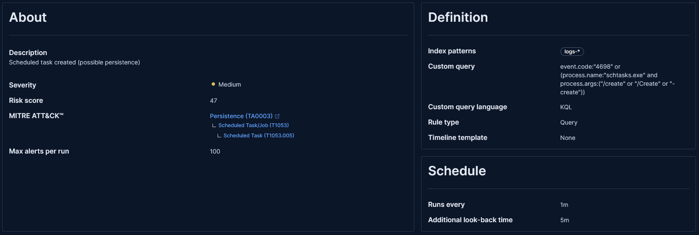

# Detection Rules

Four custom detection rules built in Kibana (Elastic Security) and validated by re-running each attack against the lab. They are written out here as logic/pseudocode; exporting them as `.ndjson` and adding Sigma equivalents is on the [next-steps list](../README.md#next-steps).

All rules run against the `logs-*` index pattern.

---

## 1. Brute-force SMB success

- **Type:** Event Correlation (EQL sequence)
- **Severity:** High · **Risk score:** 73
- **MITRE:** [T1110.001](https://attack.mitre.org/techniques/T1110/001/) Password Guessing
- **Idea:** several failed logons followed by a success, same user and source IP, inside one minute.

```eql
sequence by winlog.event_data.TargetUserName, source.ip with maxspan=1m
  [authentication where event.code == "4625"] with runs=4
  [authentication where event.code == "4624" and winlog.logon.type == "3"]
```

**Why it works:** a single 4625 is noise. Four or more failures immediately followed by a successful *network* logon (type 3) from the same origin is the signature of a successful guessing attack. Grouping by user + source IP keeps unrelated failures across the environment from correlating by accident.

**Validation:** re-ran the brute force; the alert fired within ~2 minutes. See [docs/05-brute-force.md](../docs/05-brute-force.md).

---

## 2. Sensitive file access through SMB (possible exfiltration)

- **Type:** Custom query
- **Severity:** Critical · **Risk score:** 99
- **MITRE:** [T1039](https://attack.mitre.org/techniques/T1039/) Data from Network Shared Drive
- **Idea:** any read of the decoy file is suspicious by definition.

```kql
event.code: "5145" and winlog.event_data.ShareName: "\\\\*\\Finances"
  and winlog.event_data.RelativeTargetName: "users_passwords.txt"
```

**Why it works:** `users_passwords.txt` in the `Finances` share is a **honey token** — no legitimate user has any reason to open it, so a match is almost certainly malicious. No sequence is needed; a single event is enough. This gives a very low false-positive rate.

**Validation:** read the file from Parrot; the Critical alert fired within ~1 minute. See [docs/07-collection-and-exfiltration.md](../docs/07-collection-and-exfiltration.md).

---

## 3. Mass file scanning via SMB (potential automated collection)

- **Type:** Threshold
- **Severity:** High
- **MITRE:** [T1039](https://attack.mitre.org/techniques/T1039/) Data from Network Shared Drive · [T1119](https://attack.mitre.org/techniques/T1119/) Automated Collection
- **Idea:** one IP touching many files in a short window looks like an automated crawl, not a human.

```
Index:     logs-*
Query:     event.code: "5145"
Group by:  source.ip
Threshold: >= 20 events
Window:    per 5 minutes
```

**Why it works:** a person opens a file or two; a share-crawling tool opens dozens in seconds. Counting 5145 events per source IP catches the smash-and-grab case that the single-file honey rule above would miss.

**Validation:** ran an automated share crawl from Parrot; the alert fired. See [docs/07-collection-and-exfiltration.md](../docs/07-collection-and-exfiltration.md).

---

## 4. Scheduled task created (possible persistence)

- **Type:** Custom query (KQL) · runs every 1 minute, 5 minute look-back
- **Severity:** Medium · **Risk score:** 47
- **MITRE:** [T1053.005](https://attack.mitre.org/techniques/T1053/005/) Scheduled Task/Job: Scheduled Task (tactic: Persistence)
- **Idea:** alert whenever a scheduled task is created, from either of two independent log sources.

```kql
event.code:"4698" or
(process.name:"schtasks.exe" and process.args:("/create" or "/Create" or "-create"))
```

**Why it works:** the two halves cover each other's blind spots.

- **Event 4698** is Windows' own record that a task was registered. It fires however the task was made (`schtasks`, PowerShell `Register-ScheduledTask`, the COM API), but only if *Other Object Access Events* auditing is on.
- **The `schtasks.exe` process** with a create argument comes from the endpoint telemetry (Sysmon / Elastic Defend). It still fires if the audit policy is changed, and it records *who* ran the command and with what arguments. The argument list matches the case and dash variants an attacker might use.

**Tuning:** severity is Medium on purpose. Software installers and admins create tasks legitimately, so this is a triage signal, not a verdict. Good next filters are tasks running as `SYSTEM`, tasks whose action points to a writable path like `C:\Windows\Temp`, and creations coming from a remote (type 3) logon.

**Validation:** this rule closed a gap that the [soc-detection-validator](https://github.com/fogaccacbr/soc-detection-validator#gap-found-closed-and-proved) found. Before it existed, the scheduled-task scenario ran but produced no alert. After it was added, the validator reported 4/4 techniques detected, with this rule firing in ~31 seconds. See [docs/06-persistence-scheduled-task.md](../docs/06-persistence-scheduled-task.md).



---

## Prerequisites: auditing

None of these rules fire unless the matching Windows audit subcategories are enabled on the endpoint:

| Rule | Needs |
|---|---|
| Brute force | Logon/Logoff auditing (4624/4625) — on by default, plus process command-line auditing for context |
| Honey file & mass scanning | `File Share` and `Detailed File Share` success auditing (5140/5145) |
| Scheduled task | `Other Object Access Events` success auditing (4698), or process creation telemetry from Sysmon / Elastic Defend |
| (Recon, for context) | `Filtering Platform Packet Drop` failure auditing (5152) |

> **Lesson:** detection engineering starts at the source. A perfect rule matches nothing if the log it depends on was never generated.
