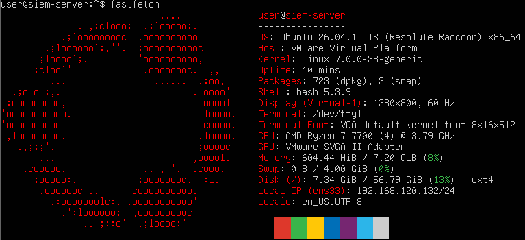
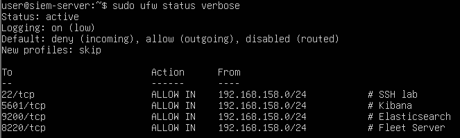
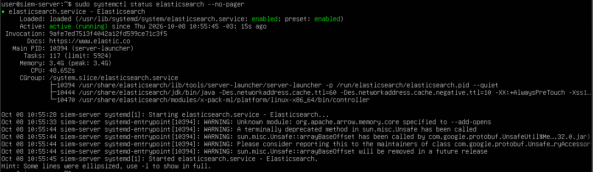
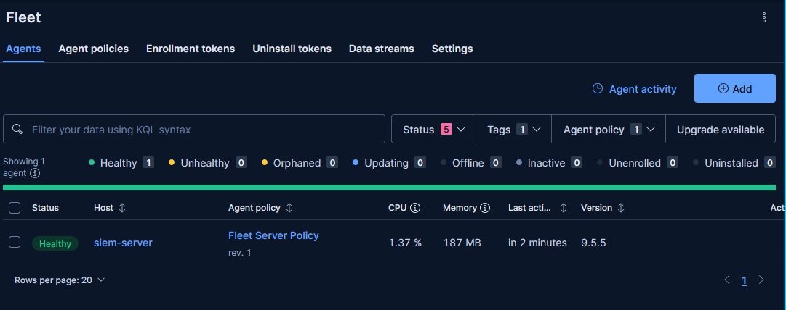
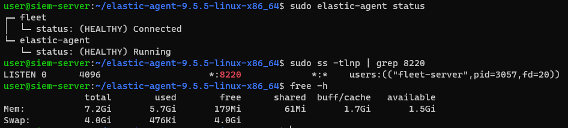
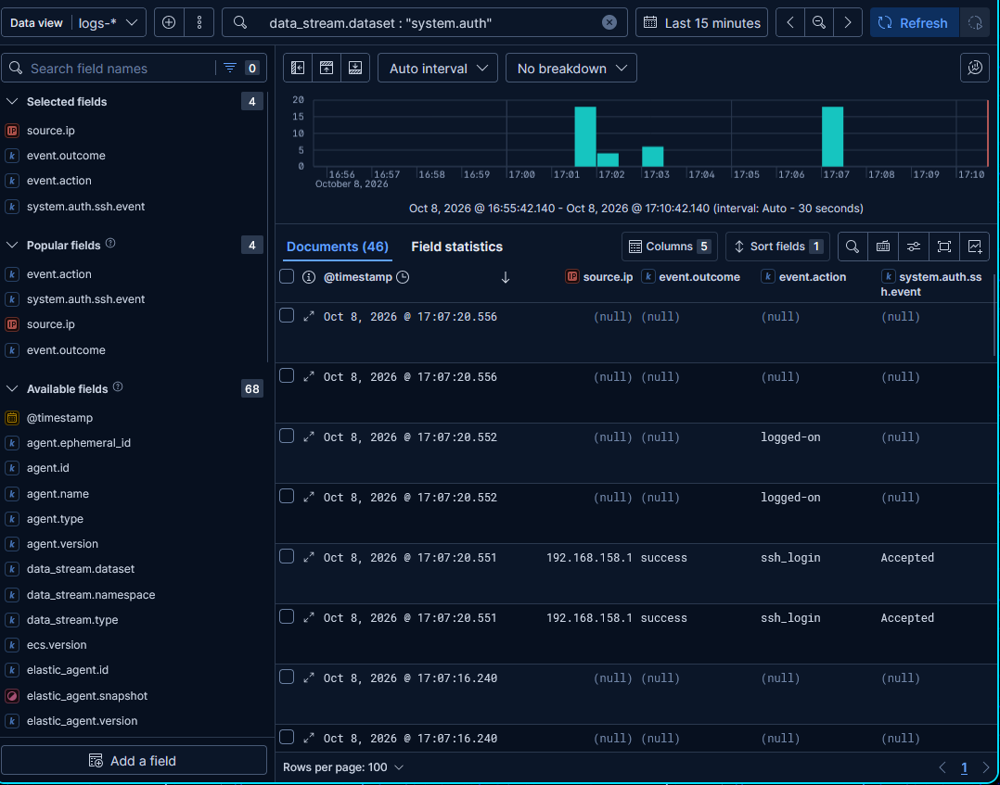

# 1. SIEM Server: Ubuntu + Elastic Stack

[← Back to README](../README.md) · [Next: Windows 10 Target →](02-windows-target.md)

## VM Setup

I created a VM in VMware Workstation running **Ubuntu Server 26.04 LTS** (4 vCPU, 8 GB RAM, 60 GB disk) with the hostname `siem-server`. This machine is the SIEM: every other VM in the lab ships its logs here through Elastic Agent.



### Network design

I wanted lab traffic separated from internet traffic, so the VM has **two network adapters**:

| Interface | Purpose | Addressing |
|---|---|---|
| `ens33` | Internet access (updates, downloading Elastic packages) | NAT, DHCP |
| `ens34` | Lab traffic: agent communication and SSH | Static `192.168.158.10/24`, **no gateway** |

The lab interface uses a static IP because agents are configured to point at the server's address. If the address changed, every agent would lose its connection.

## Firewall (UFW)

UFW denies all inbound traffic by default and only allows the lab subnet `192.168.158.0/24` to reach the required ports:

| Port | Service |
|---|---|
| 22/tcp | SSH |
| 5601/tcp | Kibana |
| 9200/tcp | Elasticsearch |
| 8220/tcp | Fleet Server |



## Elasticsearch

I added the Elastic APT repository and installed Elasticsearch. The first attempt failed because the GPG key hadn't downloaded correctly; downloading it again fixed it.

Configuration changes:

- **JVM heap** fixed at 3 GB in `/etc/elasticsearch/jvm.options.d/heap.options`. That's under half of the VM's RAM, which leaves room for the OS and Kibana.
- **Network binding** in `elasticsearch.yml`:
  ```yaml
  network.host: [192.168.158.10, _local_]
  ```
- `vm.max_map_count` raised as required by Elasticsearch.



## Kibana

I installed Kibana and set `server.host: 192.168.158.10` in `kibana.yml`. I also generated the Kibana **encryption keys** and saved them to `kibana.yml`, so that alerting rules and Fleet settings survive restarts.


## Fleet Server and Elastic Agent

Two concepts that are easy to mix up:

- **Elastic Agent** is the program installed on every machine we want to monitor. It collects logs and metrics and ships them.
- **Fleet Server** is the central point where agents enroll and receive their configuration (policies). In this single-node lab it runs on the SIEM server itself, inside an agent installed there.

**Issue I hit:** Fleet's default output pointed to the NAT address (`192.168.120.132`). That address is assigned by DHCP and can't be reached from the lab network, so agents would never be able to send data. I changed the output to `192.168.158.10` directly in the config file, keeping a backup as `kibana.yml.bak`.

Fleet Server was installed at `https://192.168.158.10:8220`. The agent shows as **Healthy** in Kibana and `elastic-agent status` reports everything connected. Memory stayed stable at about 1.5 GiB available, with almost no swap in use.





## Validating Log Collection

Before adding other machines, I tested collection on the server itself. My own SSH logins appear in the `system.auth` dataset:



I later disabled server log collection to reduce noise in the attack analysis.

---

[← Back to README](../README.md) · [Next: Windows 10 Target →](02-windows-target.md)
