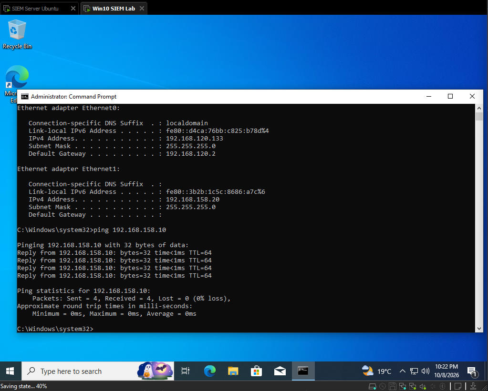
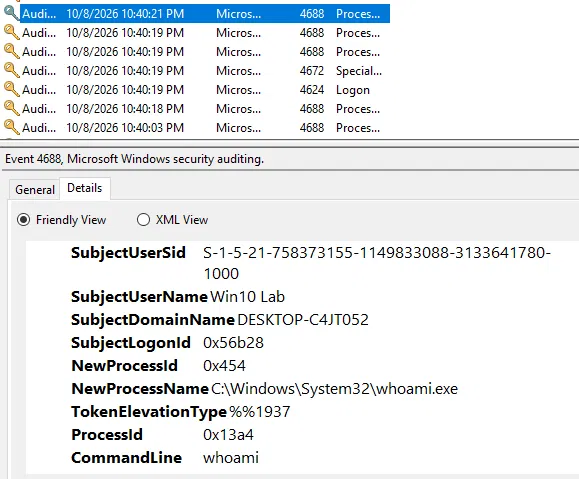
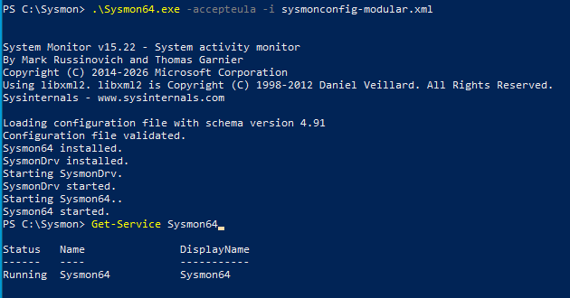
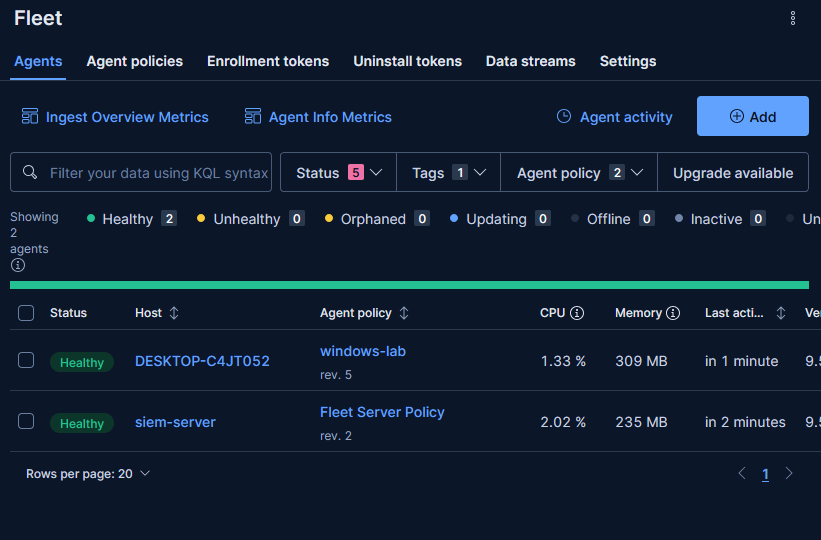
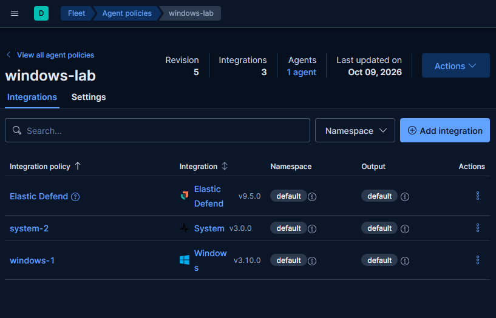
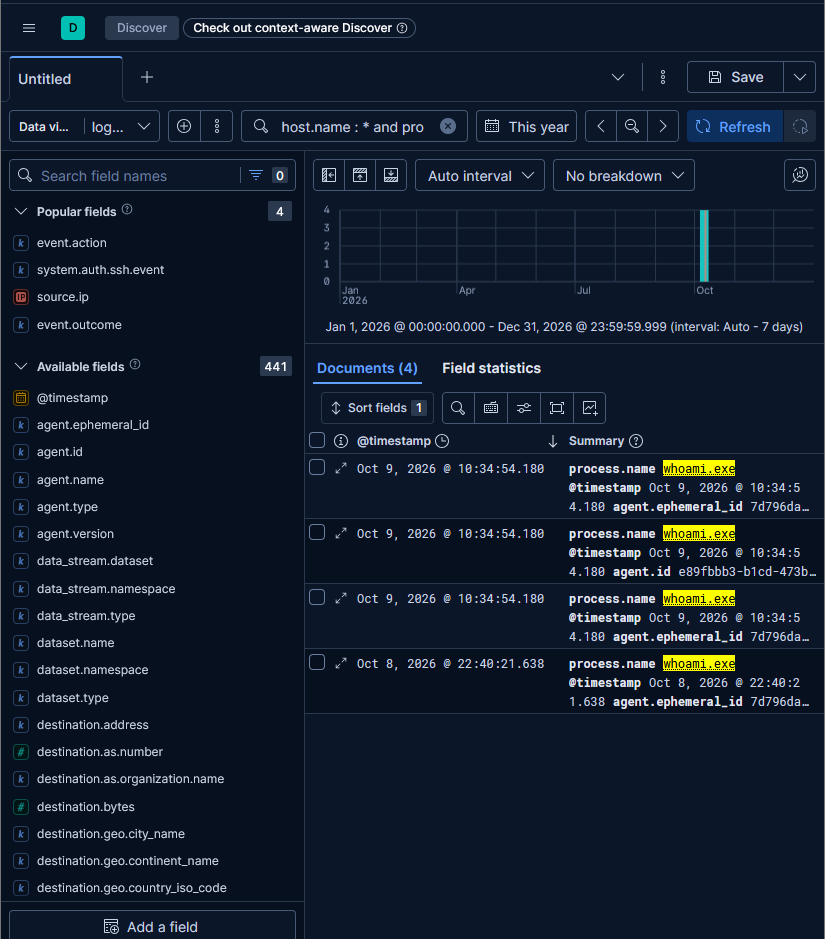

# 2. Windows 10 Target: Auditing, Sysmon and Elastic Agent

[← Previous: SIEM Server](01-siem-server.md) · [Back to README](../README.md) · [Next: Parrot OS Attacker →](03-parrot-attacker.md)

This VM is the **victim**: it generates the logs and is the target of every simulated attack.

## Network

| Adapter | Purpose | Addressing |
|---|---|---|
| Ethernet0 | Internet (updates) | NAT, DHCP |
| Ethernet1 | Lab network | Static `192.168.158.20/24` |

I confirmed connectivity to the SIEM server with `ping` and took a **clean snapshot** before changing anything else.



## Windows Audit Configuration

Out of the box, Windows logs far less than a SOC needs. I enabled:

- **Advanced Audit Policy** (logon, process creation and other subcategories)
- **Command line in process creation events**, so that event **4688** shows the full command executed
- **PowerShell logging** (module and script block logging)

I validated the change in Event Viewer. Event 4688 now shows the exact command line (`whoami`) along with the user who ran it:



## Sysmon

I installed **Sysmon** with the [sysmon-modular](https://github.com/olafhartong/sysmon-modular) configuration. I chose it over the SwiftOnSecurity config because its coverage is organized around MITRE ATT&CK techniques. The trade-off is more noise, which makes analysis a little harder.

```powershell
.\Sysmon64.exe -accepteula -i sysmonconfig-modular.xml
```



## Elastic Agent

I enrolled the machine in Fleet with its own agent policy, **`windows-lab`**, containing three integrations:

- **Windows**: Sysmon, PowerShell and other Windows event channels
- **System**: Security, Application and System event logs
- **Elastic Defend**: endpoint telemetry (EDR)





I set Elastic Defend to **detect** mode instead of **prevent**, so it would not block the attack simulations I wanted to study.

## Validation

Sysmon, Security and PowerShell logs are all reaching Elasticsearch. The `whoami.exe` execution is visible in Discover:



---

[← Previous: SIEM Server](01-siem-server.md) · [Back to README](../README.md) · [Next: Parrot OS Attacker →](03-parrot-attacker.md)
