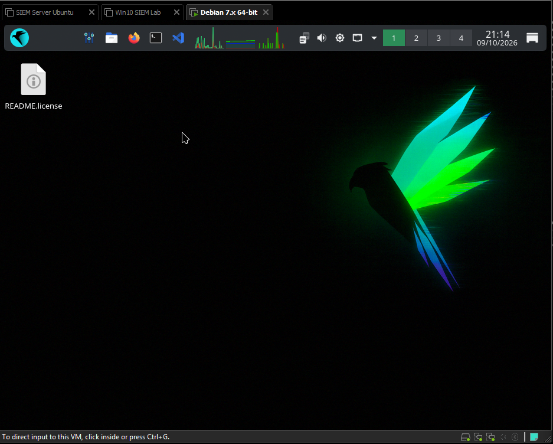
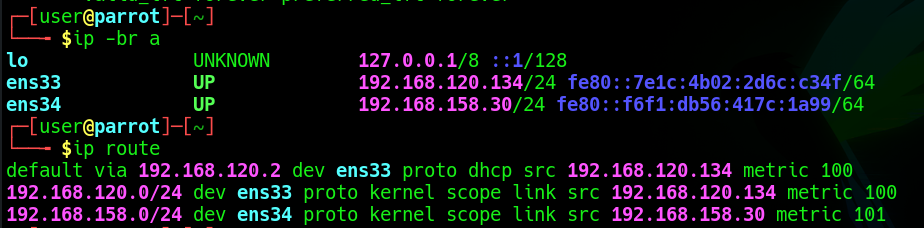

# 3. Parrot OS Attacker

[← Previous: Windows 10 Target](02-windows-target.md) · [Back to README](../README.md) · [Next: Recon & SMB Enumeration →](04-recon-and-smb-enumeration.md)

I installed **Parrot Security OS** to attack the lab network and then analyze the resulting logs in the SIEM. This setup was much simpler than the others: install the OS and configure networking.

| Interface | Purpose | Addressing |
|---|---|---|
| `ens33` | Internet (tool updates) | NAT, DHCP |
| `ens34` | Lab network | Static `192.168.158.30/24` |

---

[← Previous: Windows 10 Target](02-windows-target.md) · [Back to README](../README.md) · [Next: Recon & SMB Enumeration →](04-recon-and-smb-enumeration.md)
