# 4. Reconnaissance and SMB Enumeration

[← Previous: Parrot OS Attacker](03-parrot-attacker.md) · [Back to README](../README.md) · [Next: SMB Brute Force →](05-brute-force.md)

**MITRE ATT&CK:** [T1046](https://attack.mitre.org/techniques/T1046/) Network Service Discovery · [T1135](https://attack.mitre.org/techniques/T1135/) Network Share Discovery · [T1087](https://attack.mitre.org/techniques/T1087/) Account Discovery

## Scenario A: Firewall Enabled

### First scan

An initial nmap scan against the Windows 10 host returned all 1,000 ports as **filtered (no-response)**: the firewall silently drops the probes. The scan took 202 seconds because nmap waits for each probe to time out.

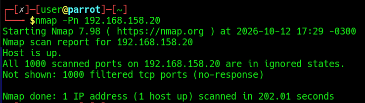

### Making dropped packets visible

By default, Windows doesn't log packets dropped by the firewall. I enabled the auditing subcategory for them:

```powershell
auditpol /set /subcategory:"Filtering Platform Packet Drop" /failure:enable
```

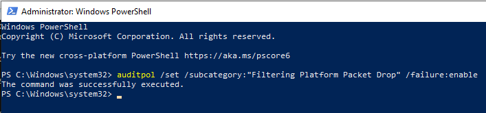

Then I repeated the scan.

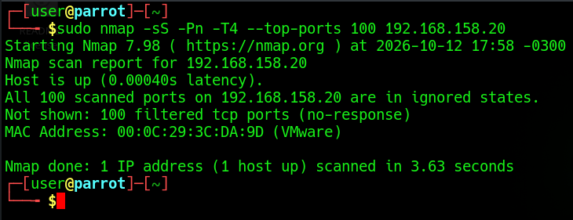

### Detection in Kibana

Searching for **event 5152** (*The Windows Filtering Platform has blocked a packet*) from the attacker's IP shows each blocked probe:

```kql
event.code: 5152 and source.ip: 192.168.158.30
```

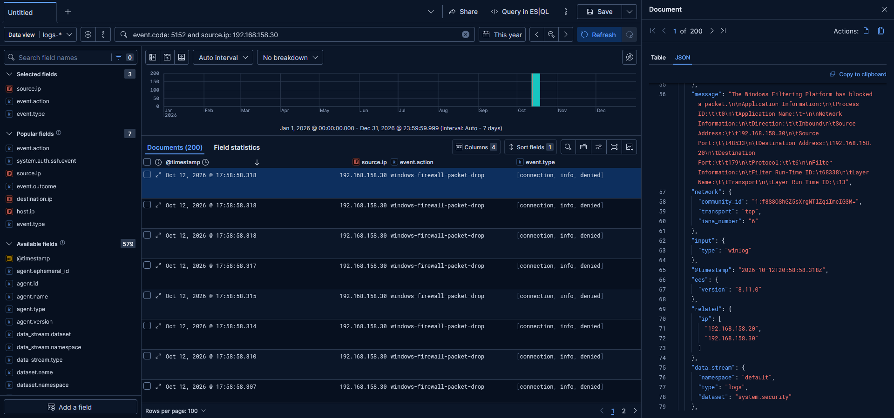

> **SOC takeaway:** Even when a scan "fails," the defender can see it — provided packet-drop auditing is on. Many 5152 events from one source to many destination ports in a short window is a classic port-scan signature.

## Scenario B: Opening the Attack Surface

With the firewall fully closed there was little to attack, so I enabled some services **on purpose** to give the lab a realistic surface to study.

The isolated lab network was being treated as **Public** by Windows. Because the network has no gateway and no DHCP responding, Windows can't identify it and assumes the most restrictive profile for safety. I switched the unnamed network's category directly with `Set-NetConnectionProfile`.

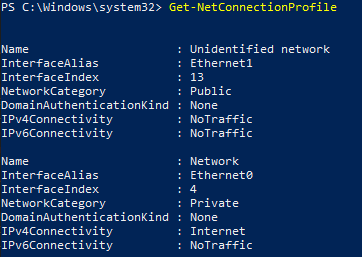

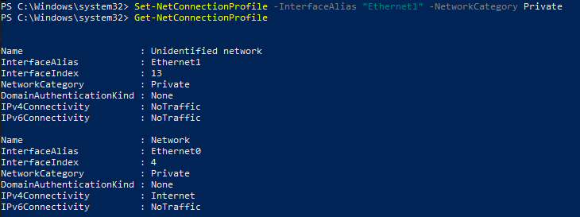

I then enabled file and printer sharing (SMB, NetBIOS) and RDP (3389). Afterward, nmap shows ports **135, 139, 445 and 3389** as open:

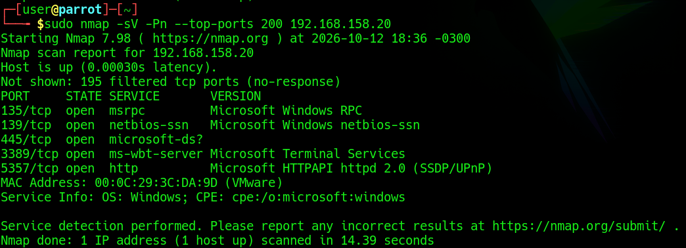

## SMB Enumeration

With SMB reachable, I enumerated it from Parrot using `enum4linux-ng`, which runs the full set of checks: null session, users, groups, shares, password policy and OS info.

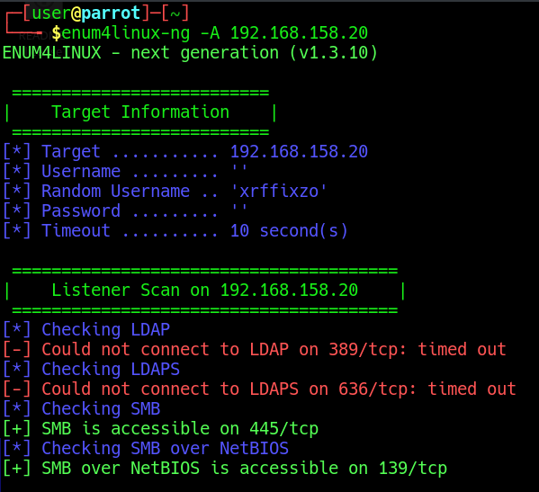

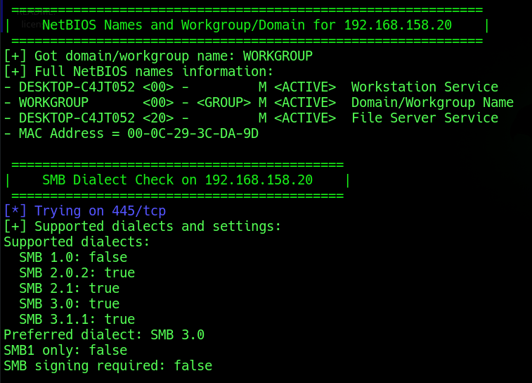

A few defensive observations stood out:

- **Anonymous (null) sessions were blocked** — `smbclient -L` and `rpcclient` both returned `NT_STATUS_ACCESS_DENIED`. Good posture: anonymous enumeration is disabled by default.

  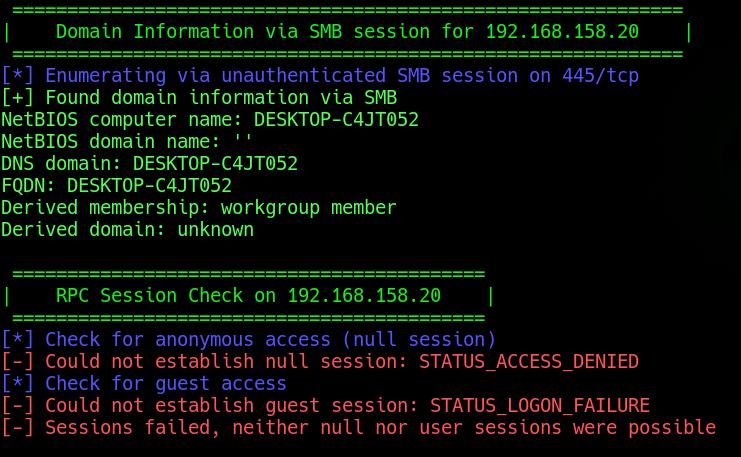

- A scan for known SMB vulnerabilities found nothing, which is expected on an up-to-date Windows 10 — but it's a good checklist habit.

  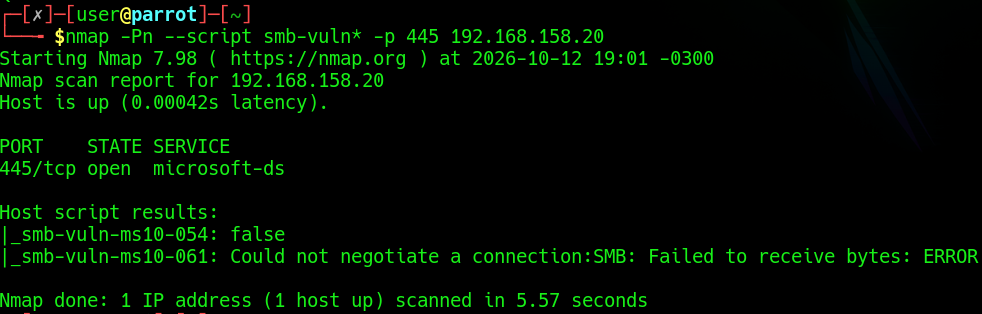

## Detection in Kibana

The enumeration attempts are clearly visible in the logs. The signature is **4624 (ANONYMOUS LOGON)** immediately followed by **4625 (failure)** in under a second, from the same source IP — the null session being rejected by security policy.


Two details that are useful for a hunter:

- `logon_type: Network` (type 3) is expected for remote SMB/RPC access — the correct signature for this kind of activity.
- The tool generated a **random username** (`xrffixzo`) for its anonymous test. A `TargetUserName` that's a random string attempting a type-3 logon is suspicious on its own, and makes a nice indicator.

> **Conclusion:** Windows held a correct security posture (null sessions disabled), so anonymous SMB enumeration failed as expected — and every attempt was logged.

---

[← Previous: Parrot OS Attacker](03-parrot-attacker.md) · [Back to README](../README.md) · [Next: SMB Brute Force →](05-brute-force.md)
