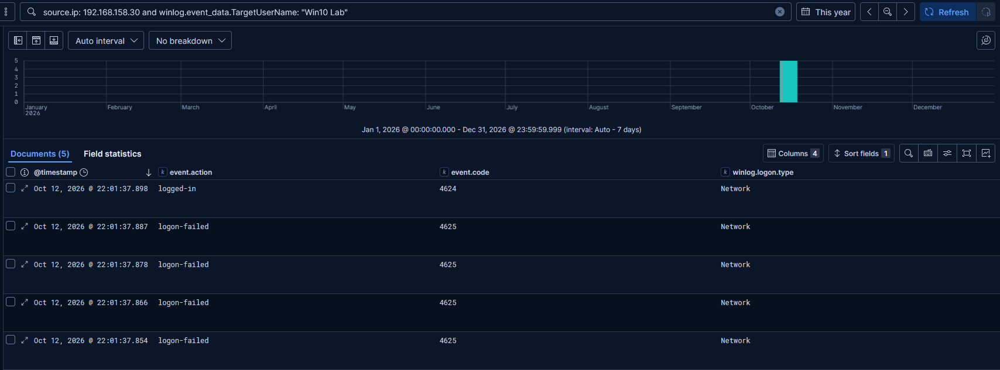
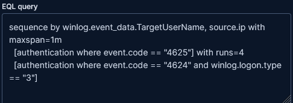
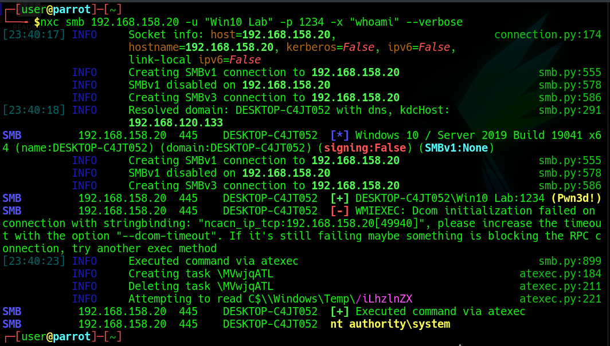

# 5. SMB Brute Force

[← Previous: Recon & SMB Enumeration](04-recon-and-smb-enumeration.md) · [Back to README](../README.md) · [Next: Persistence →](06-persistence-scheduled-task.md)

**MITRE ATT&CK:** [T1110.001](https://attack.mitre.org/techniques/T1110/001/) Brute Force: Password Guessing

The goal of this exercise was not the attack itself but the **log pattern** it produces: a long run of failed logons (**4625**) followed by a single successful logon (**4624**), a textbook brute-force signature.

I used a small test wordlist and a weak lab password (`1234`) set on purpose. The authentication attempts targeted SMB (port 445). The failures and the eventual success appear in Kibana exactly as expected.

## Detection: EQL Sequence Rule

Single failed logons are normal background noise. What makes brute force distinctive is the *sequence*. I created a custom rule in Kibana using **EQL** to express it: for the same target user and source IP, within one minute, at least four failed logons followed by a successful network logon (type 3).

After enabling the rule I re-ran the attack, and the alert fired as designed:

See [detections/README.md](../detections/README.md#1-brute-force-smb-success) for the full rule logic.

> **SOC takeaway:** Correlating events into a sequence turns a noisy indicator (failed logon) into a high-confidence one. The same technique generalizes to password spraying and other guessing attacks.

---

[← Previous: Recon & SMB Enumeration](04-recon-and-smb-enumeration.md) · [Back to README](../README.md) · [Next: Persistence →](06-persistence-scheduled-task.md)
