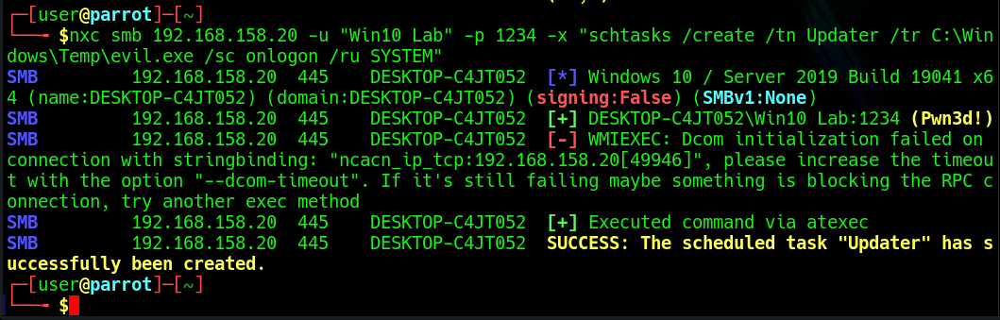
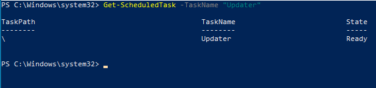
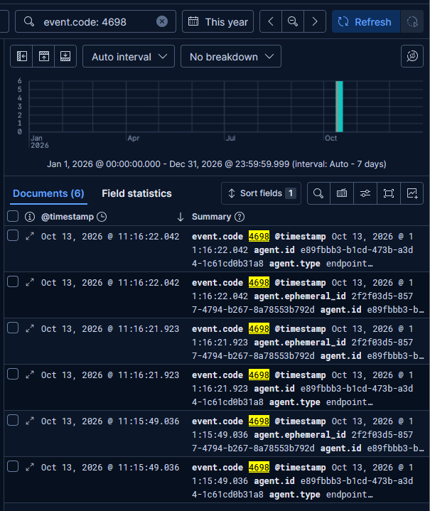

# 6. Persistence via Scheduled Task

[← Previous: SMB Brute Force](05-brute-force.md) · [Back to README](../README.md) · [Next: Collection & Exfiltration →](07-collection-and-exfiltration.md)

**MITRE ATT&CK:** [T1053.005](https://attack.mitre.org/techniques/T1053/005/) Scheduled Task/Job: Scheduled Task

After obtaining credentials in the previous step, I looked at what an attacker could do with them. A common next move is **persistence**: leaving something behind that re-runs automatically.

I created a scheduled task named `Updater` (a deliberately legitimate-sounding name) set to run at logon. The task has **no actual payload** — it exists only to generate the logs I want to analyze, which is the whole point of this lab.

A note on Windows defaults I ran into: for local accounts that aren't the built-in administrator, remote command execution is silently blocked. That's the default behavior of **UAC remote restrictions** (`LocalAccountTokenFilterPolicy`). I had to disable that restriction on the Windows host on purpose before remote execution would work — a good reminder that this control blocks a lot of lateral movement out of the box.



I confirmed the task exists with `Get-ScheduledTask`:



## Detection in Kibana

Creating a scheduled task generates event **4698** (*A scheduled task was created*). Searching for it shows the creation of the `Updater` task:

```kql
event.code: 4698
```



> **SOC takeaway:** Event 4698 is high-value for persistence hunting. Tasks created outside of patch windows, with generic names like "Updater", running as SYSTEM, and originating from a remote logon, deserve a close look.

## Detection rule

At first this attack was only covered by a hunting query: someone had to go look. My [detection validator](https://github.com/fogaccacbr/soc-detection-validator#gap-found-closed-and-proved) flagged it as the one technique in the lab with no alert, so I wrote a rule for it:

```kql
event.code:"4698" or
(process.name:"schtasks.exe" and process.args:("/create" or "/Create" or "-create"))
```

It combines the Windows audit event with the `schtasks.exe` process creation from endpoint telemetry, so it still fires if one of the two sources is missing.


Re-running the attack through the validator, the rule fired in ~31 seconds. Full rule details: [detections/README.md](../detections/README.md#4-scheduled-task-created-possible-persistence).

---

[← Previous: SMB Brute Force](05-brute-force.md) · [Back to README](../README.md) · [Next: Collection & Exfiltration →](07-collection-and-exfiltration.md)
