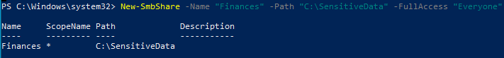
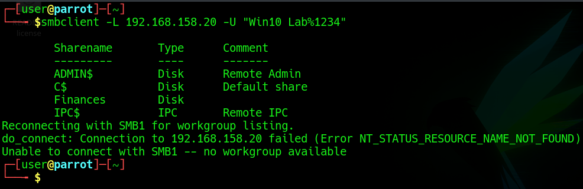
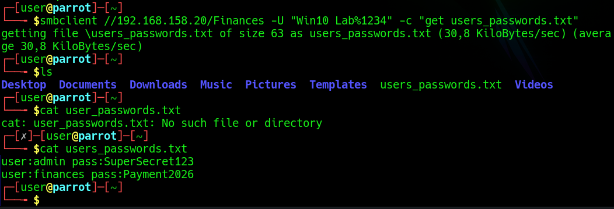
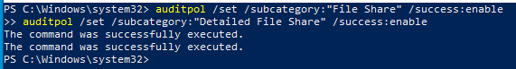
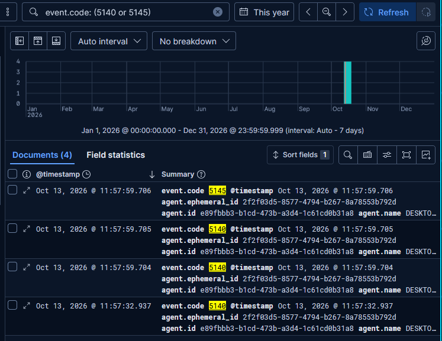
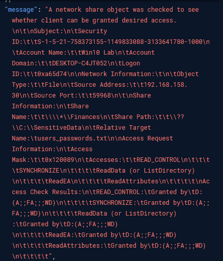
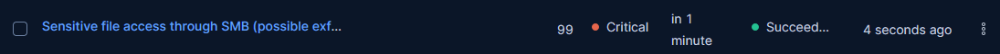
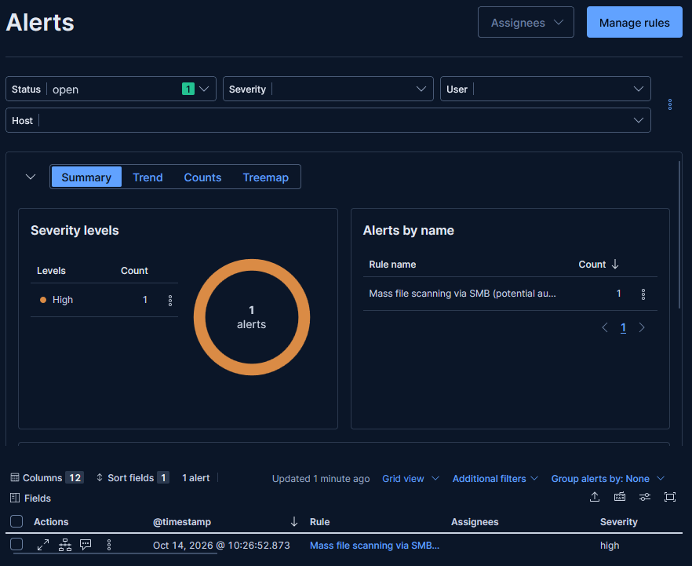

# 7. Collection and Exfiltration from SMB Shares

[← Previous: Persistence](06-persistence-scheduled-task.md) · [Back to README](../README.md) · [Next: Dashboard →](08-dashboard.md)

**MITRE ATT&CK:** [T1039](https://attack.mitre.org/techniques/T1039/) Data from Network Shared Drive · [T1119](https://attack.mitre.org/techniques/T1119/) Automated Collection

To study data-theft detection, I set up a **decoy (honey) file** and watched what an attacker reading it looks like in the logs.

## Setup on Windows

1. Created a folder `C:\SensitiveData`.
2. Added a decoy `users_passwords.txt` with fake credentials (all made up for this lab).
3. Shared the folder over SMB as **`Finances`**.



## Reading the file from Parrot

Using the credentials recovered earlier, the attacker can enumerate the shares, see `Finances`, and read the decoy file.





## Turning on the right auditing

As with the firewall drops earlier, share and file access aren't logged until the matching subcategories are enabled:

```powershell
auditpol /set /subcategory:"File Share" /success:enable
auditpol /set /subcategory:"Detailed File Share" /success:enable
```



## Detection in Kibana

With auditing on, accessing the file produces events **5140** (a network share was accessed) and **5145** (detailed check on a specific file). The expanded document is a complete forensic record:

- `event.code: 5145` — detailed file-share access check
- `Account Name: Win10 Lab` — which credential was used
- `Source Address: 192.168.158.30` — that it came from Parrot
- `Share Name: \\*\Finances` and `Relative Target Name: users_passwords.txt` — exactly which file
- `Access Mask: READ_DATA` — that it was a read





That single log line answers **who, from where, what, how and when** — the evidence that justifies mapping this to T1039.

## Two detection rules

### Honey-file rule (single event)

Because no legitimate user should ever open this decoy, a simple **custom query** rule is enough — no sequence needed. It fires on any read of `users_passwords.txt` in the `Finances` share and is rated Critical.



### Mass-access rule (threshold)

A real attacker often crawls every share automatically rather than opening one file. To catch that, I added a **threshold** rule: more than 20 file-access events (5145) from the same source IP in a short window.

I validated it by running an automated share-crawl from Parrot, and the alert fired:



Both rules are documented in [detections/README.md](../detections/README.md).

> **SOC takeaway:** Honey files are cheap and high-fidelity — almost no false positives, because nobody has a reason to touch them. Pairing a per-file rule with a volume-based rule covers both the targeted and the smash-and-grab cases.

---

[← Previous: Persistence](06-persistence-scheduled-task.md) · [Back to README](../README.md) · [Next: Dashboard →](08-dashboard.md)
