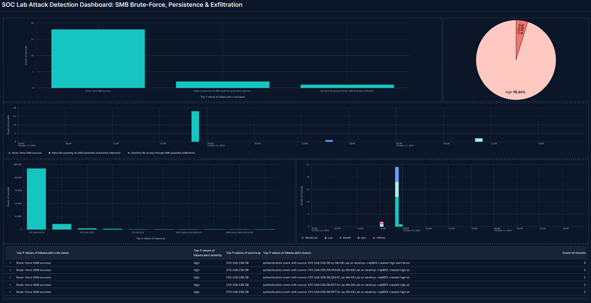
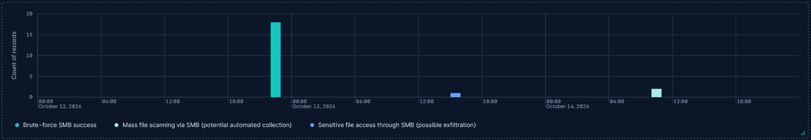
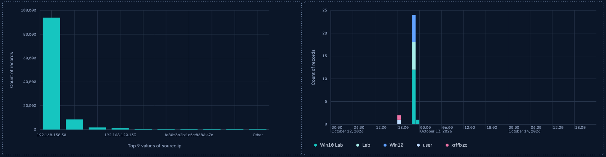
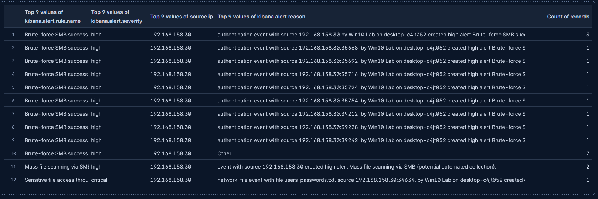

# 8. Attack Detection Dashboard

[← Previous: Collection & Exfiltration](07-collection-and-exfiltration.md) · [Back to README](../README.md)

To tie everything together, I built a Kibana dashboard that reconstructs the whole attack from a single place — the control panel for the lab.

The dashboard brings together everything detected during the simulated attacks from the Parrot VM against the Windows VM.

## Panels

### Timeline

The most useful panel is the timeline, which shows **when** each attack happened. You can read the progression top to bottom: first the brute-force attempt, then the scheduled-task persistence, and finally the file access. This is how an analyst reconstructs the order of events during a real investigation.

### Context charts

Two context panels:

- **Source IP** — proves visually that a single origin (`192.168.158.30`, the attacker) is behind everything, rather than scattered network noise.
- **Failed logins** — shows the characteristic spike of a brute-force tool trying many passwords quickly before it succeeds.

### Alerts table

A table lists each alert individually, so you can inspect the detail of a single event without leaving the dashboard for Discover.

## Summary

The dashboard summarizes **three real attack techniques** — brute force, persistence, and sensitive-data collection — each with its own detection rule that I built from scratch in Kibana, and shows that the environment detected all three end to end.

---

[← Previous: Collection & Exfiltration](07-collection-and-exfiltration.md) · [Back to README](../README.md)
